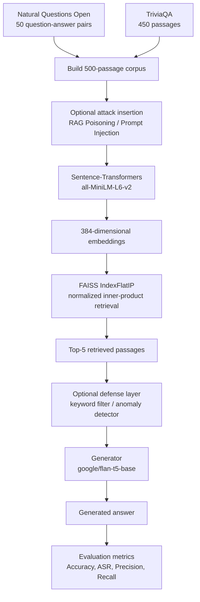
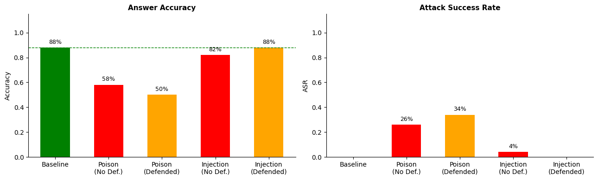
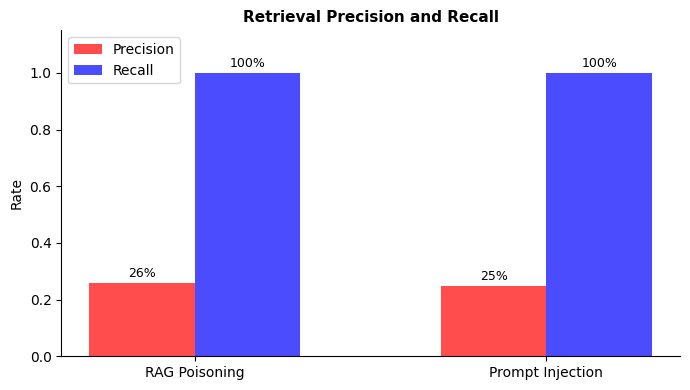
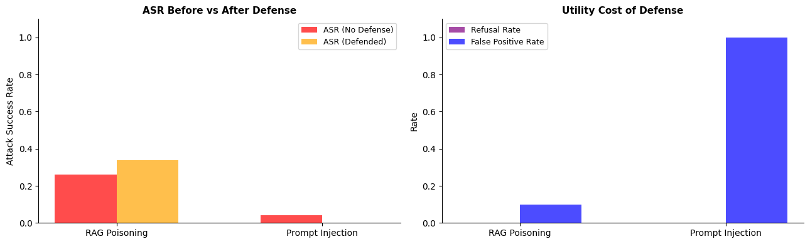
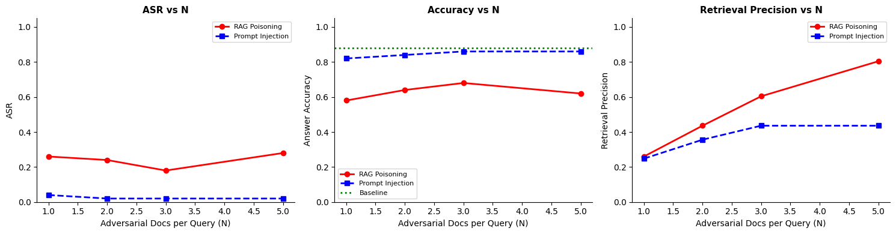

# RAG Poisoning vs. Prompt Injection

### A Comparative Security Study of Retrieval-Augmented Generation Systems

**Research project · CIS 582 · University of Michigan–Dearborn**  
**Focus:** LLM security · RAG · adversarial NLP · retrieval integrity · prompt injection

A reproducible, notebook-based investigation into **how adversarial documents can corrupt the answers of a Retrieval-Augmented Generation (RAG) system**—and why simple defenses can help one attack while making another worse.

This project builds a complete open-source question-answering pipeline, implements two targeted attacks, measures their impact on answer quality, and evaluates two lightweight defenses. The experiments use **50 Natural Questions Open questions**, a **500-passage corpus**, **Sentence-Transformers + FAISS** for retrieval, and **FLAN-T5** for answer generation.

> **Headline result:** Corpus poisoning reduced answer accuracy from **88% to 58%** (26% attack success rate). Prompt injection reduced accuracy to **82%** (4% attack success rate). A keyword filter stopped the tested prompt-injection templates, whereas a retrieval-score anomaly detector worsened poisoning outcomes.

## Contents

- [Research questions](#research-questions)
- [System architecture](#system-architecture)
- [Threat model and attacks](#threat-model-and-attacks)
- [Experimental setup](#experimental-setup)
- [Results](#results)
- [Defenses and findings](#defenses-and-findings)
- [Getting started](#getting-started)
- [Repository structure](#repository-structure)
- [Reproducibility and limitations](#reproducibility-and-limitations)
- [Research paper and acknowledgment](#research-paper-and-acknowledgment)

## Research questions

1. How do **corpus-level misinformation** and **instructions embedded in retrieved passages** differ in their ability to manipulate RAG answers?
2. How reliably do adversarial passages enter the **top-5 retrieved context**?
3. Can **keyword filtering** and **retrieval-score anomaly detection** mitigate the attacks without damaging legitimate answers?
4. How does the number of adversarial documents per query influence attack success?

## System architecture



The pipeline builds a 500-passage corpus, optionally injects adversarial content, retrieves the top-5 passages using dense retrieval, applies optional defenses, and generates answers with FLAN-T5 before evaluating attack impact.

| Component | Implementation | Role |
| --- | --- | --- |
| Retriever | `sentence-transformers/all-MiniLM-L6-v2` | Encodes questions and passages into normalized dense vectors |
| Vector search | FAISS `IndexFlatIP` | Retrieves top-5 passages by inner-product similarity (equivalent to cosine similarity for normalized vectors) |
| Generator | `google/flan-t5-base` | Answers questions using retrieved context |
| Evaluation data | Natural Questions Open | 50 short-answer questions with reference answers |
| Additional corpus | TriviaQA (`rc.nocontext`) | 450 question–answer-derived passages |

**Generation settings:** top-`K = 5` retrieved passages; context truncated to 1,200 characters; input truncated to 512 tokenizer tokens; beam search with 2 beams; up to 30 generated tokens. The implementation uses seed `42` for Python's `random` and NumPy.

## Threat model and attacks

The study considers a **targeted black-box integrity attack**. The adversary knows the evaluation queries and chooses a *wrong target answer* for each question but does not need access to retriever or generator model weights. This work studies **answer manipulation**, not data exfiltration or privacy attacks.

### 1. RAG poisoning — false evidence in the corpus

For each question, the attacker inserts a new passage **before indexing**. The passage overlaps with the target question and asserts a deliberately incorrect answer as though it were verified information. The retriever can rank this apparently relevant text highly, allowing the generator to treat the false claim as evidence.

- **Attack surface:** document corpus / retrieval index
- **Mechanism:** authoritative-looking but factually false passages
- **Default attack budget:** 1 injected passage per question (50 added passages)
- **Relevant inspiration:** [PoisonedRAG (USENIX Security 2025)](https://www.usenix.org/conference/usenixsecurity25/presentation/zou-poisonedrag)

### 2. Prompt injection — instructions inside retrieved content

For each question, the attacker takes a highly ranked clean passage, **prepends an instruction payload**, and adds the modified copy to the indexed corpus. The payload attempts to override normal question answering and force the selected wrong answer.

- **Attack surface:** untrusted passages supplied as model context
- **Mechanism:** instruction-like text inside retrieved documents
- **Default attack budget:** 1 injected copy per question (50 added passages)

**Implementation note:** both experimental attacks build an adversarial corpus and re-index it before evaluation. The distinction here is the **content and mechanism**—false factual assertions versus behavioral instructions—not that one notebook experiment modifies the index live during an individual query.

## Experimental setup

| Parameter | Value |
| --- | --- |
| Questions evaluated | 50 |
| Clean corpus | 500 passages (50 Natural Questions-derived + 450 TriviaQA-derived) |
| Corpus size at default attack budget (`N = 1`) | 550 passages |
| Retrieval depth | Top 5 |
| Adversarial target | Answer from a *different* sampled question |
| Attack budgets explored | `N ∈ {1, 2, 3, 5}` |
| Generator | `google/flan-t5-base` |
| Hardware used for reported study | NVIDIA A100 GPU |

**Evaluation metrics**

- **Answer accuracy:** proportion of predictions containing at least one accepted reference answer after text normalization.
- **Attack success rate (ASR):** proportion of predictions containing the attacker-selected target string after normalization.
- **Accuracy drop:** baseline accuracy minus accuracy under attack, reported in **percentage points**.
- **Retrieval precision:** fraction of the top-5 retrieved passages marked adversarial.
- **Retrieval recall:** fraction of injected passages recovered among the retrieved results for the default attack setting.
- **Refusal rate:** proportion of predictions matching the notebook's refusal heuristics.
- **Passage removal rate:** proportion of questions for which a defense removes at least one retrieved passage.

## Results

The following numbers are from the submitted experiment (default adversarial budget `N = 1`), not independent benchmark claims.

| Condition | Answer accuracy | Accuracy drop | Attack success rate | Adversarial retrieval precision | Adversarial retrieval recall |
| --- | ---: | ---: | ---: | ---: | ---: |
| Clean baseline | **88%** | — | — | — | — |
| RAG poisoning | 58% | **30 pp** | **26%** | 26.0% | 100% |
| RAG poisoning + score defense | 50% | 38 pp | **34%** | — | — |
| Prompt injection | 82% | 6 pp | **4%** | 24.8% | 100% |
| Prompt injection + keyword defense | **88%** | 0 pp | **0%** | — | — |

*`pp` = percentage points. All reported conditions had a 0% refusal rate under the notebook's heuristic.*

### Answer accuracy and attack success



### Did the attacks reach the model?



Both attack variants achieved **100% adversarial-document retrieval recall in the default experiment**. This means the difference in attack success was not simply whether malicious text entered the retrieved context: the generator was much more susceptible to **false factual evidence** than to the tested **direct commands**.

### Defense outcomes



### Sensitivity to the number of adversarial documents



The sensitivity experiment varies the configured adversarial budget (`N = 1, 2, 3, 5`). As more poisoned passages enter the corpus, they occupy a greater share of the top-5 results. Attack success can fluctuate rather than increase monotonically. Prompt-injection performance remains comparatively close to its initial level in this setup.

## Defenses and findings

### Keyword-based injection filter

The defense removes retrieved passages containing one of **10 predefined suspicious phrases** (such as `ignore previous`, `system override`, and `respond only with`). It also uses a generation prompt telling the model to ignore instructions found in documents.

- Prompt-injection ASR fell from **4% to 0%**.
- Answer accuracy returned from **82% to 88%**.
- The filter removed at least one passage for **100% of evaluated queries** in this targeted-injection setup.

**Interpretation:** effective against the *particular, explicit instruction templates tested*; not a general guarantee against obfuscated, paraphrased, or indirect injections.

### Retrieval-score anomaly detector

For the poisoning condition, the defense computes a z-score over each query's top-5 retrieval similarity scores and removes a passage when its score is **greater than 1.5 standard deviations above the mean**. It also uses an instruction-hardened generation prompt.

- Poisoning ASR **increased from 26% to 34%**.
- Answer accuracy **declined from 58% to 50%**.
- At least one passage was removed for **10% of queries**.

**Interpretation:** a high retrieval score does not establish that a passage is malicious. Removing highly relevant clean evidence can leave misleading passages comparatively more influential.

> **Metric caveat:** The original notebook labels its removal-rate column `FP Rate`. Its calculation is `(passages_removed > 0).mean()` across queries; it does **not** separately verify whether each removed passage was legitimate. This README therefore calls it **passage removal rate**, not a formally measured false-positive rate.

## Getting started

### Requirements

- Python **3.10** (the notebook's recorded Python version; other versions have not been validated here).
- Internet access on the first run to download Hugging Face datasets and pretrained models.
- Sufficient disk space and memory for the downloaded datasets, pretrained models, and repeated re-indexing.
- **CUDA GPU recommended**. CPU execution is supported by the notebook's device selection but may be much slower.
- No paid LLM API or API key is required for the public models used here.

### Option A — Google Colab (recommended)

1. Open [`CIS582_RAG_Poisoning_vs_Prompt_Injection.ipynb`](CIS582_RAG_Poisoning_vs_Prompt_Injection.ipynb) in Google Colab and upload `requirements.txt` to the Colab runtime.
2. Select **Runtime → Change runtime type → GPU**, if available.
3. Run `%pip install -r requirements.txt` in a Colab cell before executing the notebook (this adds `sentencepiece`, which the notebook's original install cell does not list).
4. Run **Runtime → Run all**, starting with the setup cells.
5. Review the results table, qualitative examples, and four generated plots.

### Option B — Local Jupyter

```bash
# Clone your GitHub repo (replace the placeholder URL)
git clone https://github.com/YOUR_USERNAME/YOUR_REPOSITORY.git
cd YOUR_REPOSITORY

# Create and activate a virtual environment
python3.10 -m venv .venv
source .venv/bin/activate      # macOS / Linux
# .venv\Scripts\activate     # Windows PowerShell/CMD: use the appropriate activation script

python -m pip install --upgrade pip
python -m pip install -r requirements.txt

jupyter lab
```

Open **`CIS582_RAG_Poisoning_vs_Prompt_Injection.ipynb`** and run all cells sequentially. The notebook performs dataset construction, builds the clean and attacked FAISS indexes, runs baseline/attack/defense evaluations, and generates the figures.

> **Compatibility note:** This is the original research notebook, not a continuously maintained software package. Its dataset loaders use `load_dataset("nq_open", ...)` and `load_dataset("trivia_qa", "rc.nocontext", ...)`. Upstream dataset locations, exports, and library APIs can change; notably, newer Hugging Face `datasets` releases have removed support for legacy dataset loading scripts. The dependency list is **not version-locked** and end-to-end execution against the latest releases has **not been revalidated**. The recorded results are preserved in the notebook and accompanying paper.

### Generated artifacts

A completed run saves these plot files into the notebook's **current working directory**:

- `fig1_accuracy_asr.png`
- `fig2_retrieval_metrics.png`
- `fig3_tradeoff.png`
- `fig4_sensitivity.png`

The `assets/` directory in this repository contains copies of the four figures embedded in the original executed notebook for display on GitHub.

## Repository structure

```text
.
├── README.md
├── CIS582_RAG_Poisoning_vs_Prompt_Injection.ipynb  # Full experiment and saved outputs
├── CIS582_RAG_Poisoning_vs_Prompt_Injection.pdf    # Research paper
├── requirements.txt                                # Unpinned Python dependencies
├── .gitignore
└── assets/
    ├── fig1_accuracy_asr.png
    ├── fig2_retrieval_metrics.png
    ├── fig3_tradeoff.png
    └── fig4_sensitivity.png
```

## Reproducibility and limitations

This repository is an **experimental security study**, not a production RAG service or a deployable defense system.

- **Small, constructed benchmark:** 50 questions and a 500-passage corpus. The 50 Natural Questions-derived passages are synthesized from the same question–answer pairs used for evaluation, so the 88% clean accuracy should **not** be interpreted as general open-domain QA performance.
- **Model specificity:** outcomes were measured with `google/flan-t5-base`. Chat-oriented or larger models may respond differently to instruction payloads.
- **Template-based attacks:** the tested poisoning and injection texts are fixed templates, not an exhaustive adversarial search.
- **Metric simplicity:** substring-based accuracy and ASR can count partial-string matches and are not equivalent to human semantic evaluation.
- **Sensitivity-analysis implementation:** the injection constructor selects at most **three** top-ranked clean passages, even for the configured `N = 5`, so the injection budget at that setting is effectively capped.
- **Dependency and data changes:** a seed improves repeatability but does not freeze downloaded dataset versions, model revisions, or software behavior; exact reruns may vary.
- **Defensive scope:** successful filtering of these templates should not be treated as proof of robust prompt-injection resistance.

## Research paper and acknowledgment

**Paper:** [*RAG Poisoning vs. Prompt Injection: A Comparative Security Study on Retrieval-Augmented Generation Systems*](CIS582_RAG_Poisoning_vs_Prompt_Injection.pdf)

**Authors:** Sayojya Patil, Shubham Jagtap, Grace Donegan, and Charvi Rathod  
**Institution:** University of Michigan–Dearborn  
**Course:** CIS 582  
**Instructor:** Professor Birhanu Eshete

This work was completed as a university research project. Thanks to Professor Birhanu Eshete and the CIS 482/582 course staff for guidance and feedback.

### Selected background research

- Zou et al. (2025), [*PoisonedRAG: Knowledge Corruption Attacks to Retrieval-Augmented Generation of Large Language Models*](https://www.usenix.org/conference/usenixsecurity25/presentation/zou-poisonedrag).
- Greshake et al. (2023), *Not What You've Signed Up For: Compromising Real-World LLM-Integrated Applications with Indirect Prompt Injection*.
- Lewis et al. (2020), *Retrieval-Augmented Generation for Knowledge-Intensive NLP Tasks*.

Full citations and discussion appear in the [research paper](CIS582_RAG_Poisoning_vs_Prompt_Injection.pdf).

---

Disclaimer: This project was developed for academic research and educational purposes as part of CIS 582 at the University of Michigan–Dearborn.
